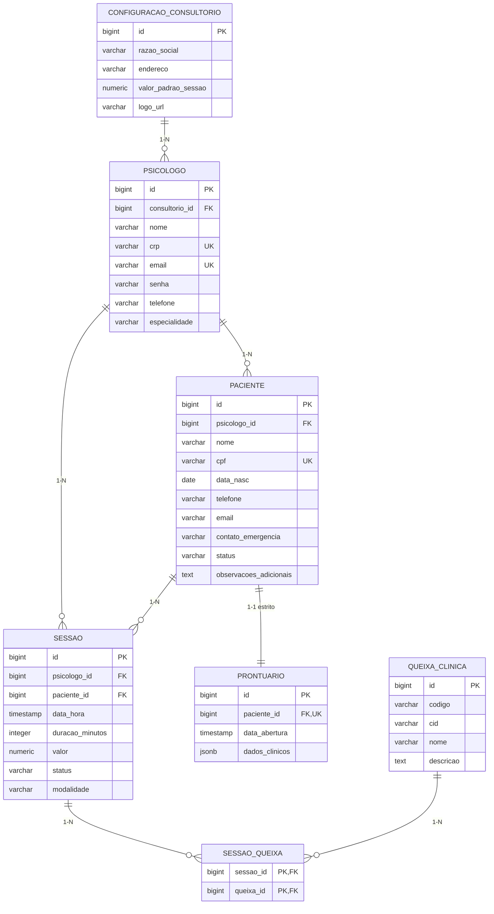

# ESPECIFICAÇÃO DE REQUISITOS DE SOFTWARE
## Kallos Psi — Plataforma de Gestão Clínica para Psicologia
### Requisitos Funcionais do Frontend, Regras de Negócio e Arquitetura de Telas

| Campo | Detalhe |
|---|---|
| **Versão** | 1.0 |
| **Data** | 07 de novembro de 2026 |
| **Equipe** | Richard Silva, Matheus Alves, Micael Barros, Ruan Ricardo e Rafael Pimentel |
| **Frontend** | Next.js 14 · Zustand · TanStack Query |
| **API consumida** | API REST em Spring Boot 3 / Java 21 (requisitos do backend em documento próprio) |

---

## Controle de Versões

| Versão | Data | Descrição | Responsável |
|---|---|---|---|
| 1.0 | 07/11/2026 | Requisitos funcionais do frontend, regras de negócio, integrações e divisão de telas. | Equipe do projeto |

---

## Sumário

1. [Introdução](#1-introdução)
   - 1.1 Descrição do projeto
   - 1.2 Intenção do projeto
   - 1.3 Escopo deste documento
   - 1.4 Definições e siglas
   - 1.5 Referências
2. [Visão Geral do Sistema](#2-visão-geral-do-sistema)
   - 2.1 Perfis de usuário e atores
   - 2.2 Premissas e restrições
3. [Arquitetura e Taxonomia das 11 Telas](#3-arquitetura-e-taxonomia-das-11-telas)
4. [Requisitos Funcionais do Frontend](#4-requisitos-funcionais-do-frontend)
   - 4.1 Autenticação e Acesso
   - 4.2 Painel Geral
   - 4.3 Gestão de Pacientes
   - 4.4 Agenda e Consultas
   - 4.5 Prontuário e CID
   - 4.6 Queixas e Abordagens
   - 4.7 Sala de Teleconsulta
   - 4.8 Financeiro
   - 4.9 Documentos e Atestados
   - 4.10 Configurações
5. [Regras de Negócio](#5-regras-de-negócio)
6. [Requisitos Não Funcionais](#6-requisitos-não-funcionais)
7. [Integrações Externas](#7-integrações-externas)
8. [Modelo de Dados de Referência](#8-modelo-de-dados-de-referência)
   - 8.1 Diagrama Entidade-Relacionamento
   - 8.2 Entidades e relações
   - 8.3 Campo JSON do prontuário
   - 8.4 Resumo das cardinalidades
9. [Design System](#9-design-system)
   - 9.1 Paleta de cores
   - 9.2 Tipografia e ícones
10. [Divisão de Responsabilidades](#10-divisão-de-responsabilidades)
    - 10.1 Telas por integrante
    - 10.2 Regras de trabalho
11. [Critérios de Entrega e Aceite](#11-critérios-de-entrega-e-aceite)
    - 11.1 Roteiro do vídeo de demonstração (3 minutos)
    - 11.2 Regras de envio e penalidades
    - 11.3 Priorização por ciclo
12. [Matriz de Rastreabilidade](#12-matriz-de-rastreabilidade)
13. [Diretrizes Técnicas do Frontend](#13-diretrizes-técnicas-do-frontend)
    - 13.1 Cliente HTTP e estado
    - 13.2 Estados de carregamento e erro

---

## 1. Introdução

### 1.1 Descrição do projeto
O Kallos Psi é uma plataforma web de gestão clínica voltada a psicólogos e consultórios de psicologia. O sistema reúne em um único ambiente o cadastro de pacientes, a agenda de consultas, o prontuário sigiloso com classificação CID-10/11, o catálogo de queixas clínicas, a teleconsulta, o controle financeiro de honorários e a emissão de documentos e atestados.

A solução é composta por um frontend em Next.js 14 e por uma API REST em Spring Boot 3 (Java 21) com persistência em PostgreSQL. Este documento especifica o frontend; os requisitos do backend serão documentados à parte.

### 1.2 Intenção do projeto
O projeto tem duas intenções complementares:
- **Intenção de produto**: substituir planilhas, agendas de papel e ferramentas dispersas por um sistema único, seguro e organizado, que reduza o trabalho administrativo do psicólogo e preserve o sigilo das informações clínicas, em conformidade com a LGPD e o Código de Ética Profissional do Psicólogo.
- **Intenção acadêmica**: demonstrar, em projeto final de grupo com 5 integrantes, o domínio de uma arquitetura full stack completa: CRUDs com persistência real, as 3 cardinalidades do modelo relacional (1-1, 1-N e N-N), consumo de APIs externas, autenticação com JWT e divisão comprovada de trabalho no histórico do GitHub.

### 1.3 Escopo deste documento

**Dentro do escopo:**
- As 11 telas da aplicação e seus requisitos funcionais de frontend.
- Regras de negócio e requisitos não funcionais que afetam a interface.
- Consumo da API do sistema e das integrações externas BrasilAPI (CEP e feriados) e Jitsi Meet.
- Design system, divisão de telas entre os integrantes e critérios de entrega.

**Fora do escopo:**
- Requisitos e implementação do backend, em documento próprio.
- Acesso direto do paciente ao sistema (portal do paciente).
- Emissão fiscal de notas e integração bancária.
- Aplicativo móvel nativo.

### 1.4 Definições e siglas

| Termo | Significado |
|---|---|
| **RF-F** | Requisito Funcional de Frontend. |
| **RNF** | Requisito Não Funcional: qualidade, restrição ou padrão técnico. |
| **RN** | Regra de Negócio: política que condiciona o comportamento do sistema. |
| **CRP** | Conselho Regional de Psicologia: número de registro profissional do psicólogo. |
| **CID-10/11** | Classificação Internacional de Doenças, 10ª e 11ª revisões (ex.: F41.1). |
| **TCC** | Terapia Cognitivo-Comportamental. |
| **CRUD** | Create, Read, Update, Delete: operações básicas de persistência. |
| **JWT** | JSON Web Token: token de autenticação assinado. |
| **LGPD** | Lei Geral de Proteção de Dados Pessoais. |
| **TAG / TDAH** | Transtorno de Ansiedade Generalizada / Transtorno de Déficit de Atenção e Hiperatividade. |

### 1.5 Referências
- Plano Mestre do Projeto Final: Especificação Oficial de Telas e Arquitetura Técnica.
- Parecer Técnico e Respostas aos Pontos em Aberto, de Richard da Silva Souza (07/11/2026).
- Documentação da BrasilAPI e do Jitsi Meet.

---

## 2. Visão Geral do Sistema

### 2.1 Perfis de usuário e atores

| Ator | Papel no sistema |
|---|---|
| **Psicólogo** | Único usuário autenticado. Identificado por e-mail ou CRP. Em consultório com vários profissionais, cada psicólogo vê apenas os próprios pacientes, sessões e prontuários. |
| **Paciente** | Entidade gerenciada pelo psicólogo. Não possui acesso direto ao sistema nesta versão. |
| **Serviços externos** | BrasilAPI (CEP e feriados) e Jitsi Meet (videochamada), consumidos pela interface. |

### 2.2 Premissas e restrições
- Frontend em Next.js 14 com Zustand (estado global e sessão) e TanStack Query (cache de dados da API).
- A biblioteca de componentes é de livre escolha da equipe (Tailwind CSS, Radix UI, Mantine ou MUI), priorizando acessibilidade e padronização visual.
- O frontend consome a API REST do sistema sob o prefixo `/api/v1`; os dados exibidos seguem o modelo de referência do capítulo 8.
- Nenhum emoji na interface; ícones da biblioteca Phosphor Icons (padrão) ou Lucide.

---

## 3. Arquitetura e Taxonomia das 11 Telas

A aplicação é organizada em três blocos: acesso, núcleo clínico e ferramentas de suporte.

| Módulo | Nº | Tela | Descrição | Responsável |
|---|---|---|---|---|
| **Autenticação e Acesso** | 1 | Login | Autenticação do psicólogo via e-mail/CRP, com JWT persistido no Zustand. | Ruan Ricardo |
| | 2 | Esqueci Minha Senha | Recuperação de senha com envio de código/token. | Ruan Ricardo |
| **Núcleo Clínico** | 3 | Painel Geral | Dashboard com métricas executivas, faturamento e atendimentos de hoje. | Micael Barros |
| | 4 | Gestão de Pacientes | CRUD 1: cadastro, consulta, edição e exclusão com busca preditiva. | Richard Silva |
| | 5 | Agenda e Consultas | CRUD 2: agendamento (1-N), status e vínculo N-N com queixas. | Richard Silva |
| | 6 | Prontuário e CID | Relação 1-1: prontuário sigiloso com CID principal e secundário e notas de TCC. | Matheus Alves |
| | 7 | Queixas e Abordagens | Relação N-N: catálogo de queixas clínicas indexadas às sessões. | Matheus Alves |
| **Ferramentas de Suporte** | 8 | Sala de Teleconsulta | Videochamada criptografada via Jitsi Meet com bloco de notas lateral. | Matheus Alves |
| | 9 | Financeiro | Honorários, faturamento mensal e recibos para reembolso. | Rafael Pimentel |
| | 10 | Documentos e Atestados | Declaração de comparecimento e laudos em PDF. | Rafael Pimentel |
| | 11 | Configurações | Dados do consultório, logo, valor padrão da sessão e número do CRP. | Micael Barros |

### Submódulos da tela Gestão de Pacientes (tela 4)

| Item | Submódulo | Descrição |
|---|---|---|
| **4.1** | Listagem Principal | Tabela paginada com busca preditiva por Nome/CPF e filtro por status. |
| **4.2** | Visualização (Drawer) | Modo leitura em drawer lateral com histórico rápido do paciente. |
| **4.3** | Formulário de Edição/Cadastro | Formulário unificado com abas temáticas. |
| **4.3.1** | Dados Pessoais | Nome, CPF validado, data de nascimento e canais de contato. |
| **4.3.2** | Endereço (BrasilAPI) | Autocompletar a partir do CEP de 8 dígitos. |
| **4.3.3** | Definições Clínicas | Honorário customizado por sessão, vínculo com diagnóstico CID e observações do paciente. |
| **4.4** | Sessões Vinculadas | Logs de presença (relação 1-N) e atalho direto para honorários. |

---

## 4. Requisitos Funcionais do Frontend

Requisitos da interface em Next.js 14, agrupados por tela. A coluna **Consome (API)** indica a rota da API do sistema, ou o serviço externo, que cada requisito utiliza; as rotas são a proposta de contrato, a confirmar com o backend antes da codificação. As telas são sempre citadas pelo nome, seguido do número entre parênteses.

Prioridade: **Essencial** (indispensável para a entrega), **Importante** ou **Desejável**.

### 4.1 Autenticação e Acesso
**Telas:** Login (tela 1) e Esqueci Minha Senha (tela 2) — **Responsável:** Ruan Ricardo

| ID | Requisito | Descrição e regra | Consome (API) | Prioridade |
|---|---|---|---|---|
| **RF-F01** | Login do psicólogo | Na tela Login, o psicólogo informa e-mail ou CRP e senha; em caso de sucesso, é redirecionado ao Painel Geral. | `POST /auth/login` | Essencial |
| **RF-F02** | Persistência de sessão | O JWT e os dados do usuário recebidos no login são guardados no Zustand Store e mantêm a sessão durante a navegação. | `POST /auth/login` | Essencial |
| **RF-F03** | Recuperação de senha | A tela Esqueci Minha Senha solicita o e-mail, aciona o envio do código/token e permite cadastrar a nova senha. | `POST /auth/forgot-password`<br>`POST /auth/reset-password` | Essencial |
| **RF-F04** | Proteção de rotas | Todas as telas, exceto Login e Esqueci Minha Senha, exigem sessão ativa. Sem JWT válido, ou ao receber 401 da API, o usuário volta à tela Login. | Resposta 401 da API | Essencial |

### 4.2 Painel Geral
**Telas:** Painel Geral (tela 3) — **Responsável:** Micael Barros

| ID | Requisito | Descrição e regra | Consome (API) | Prioridade |
|---|---|---|---|---|
| **RF-F05** | Métricas executivas | O Painel Geral exibe cartões com indicadores do consultório (pacientes ativos, sessões do período, entre outros). | `GET /dashboard/resumo` | Importante |
| **RF-F06** | Faturamento | O Painel Geral apresenta o faturamento do período corrente. | `GET /dashboard/resumo` | Importante |
| **RF-F07** | Atendimentos de hoje | O Painel Geral lista as sessões do dia com horário, paciente, modalidade e status. | `GET /dashboard/atendimentos-hoje` | Importante |

### 4.3 Gestão de Pacientes
**Telas:** Gestão de Pacientes (tela 4), com Listagem Principal (4.1), Visualização em Drawer (4.2), Formulário de Edição/Cadastro (4.3, abas 4.3.1 a 4.3.3) e Sessões Vinculadas (4.4) — **Responsável:** Richard Silva

| ID | Requisito | Descrição e regra | Consome (API) | Prioridade |
|---|---|---|---|---|
| **RF-F08** | Listagem de pacientes | A Listagem Principal (4.1) mostra os pacientes em tabela paginada. | `GET /pacientes?busca=&status=&page=` | Essencial |
| **RF-F09** | Busca preditiva | A Listagem Principal oferece busca por nome e CPF, atualizando os resultados enquanto o usuário digita (com debounce). | `GET /pacientes?busca=&status=&page=` | Essencial |
| **RF-F10** | Filtro por status | A Listagem Principal permite filtrar os pacientes pelo status do cadastro. | `GET /pacientes?busca=&status=&page=` | Importante |
| **RF-F11** | Visualização em drawer | Ao selecionar um paciente, a Visualização em Drawer (4.2) abre em modo leitura com o histórico rápido do paciente. | `GET /pacientes/{id}`<br>`GET /pacientes/{id}/sessoes` | Importante |
| **RF-F12** | Cadastro de paciente | O Formulário de Edição/Cadastro (4.3) cria um paciente, com abas temáticas e salvamento único. | `POST /pacientes` | Essencial |
| **RF-F13** | Edição de paciente | O mesmo formulário carrega os dados atuais do paciente e os atualiza. | `GET /pacientes/{id}`<br>`PUT /pacientes/{id}` | Essencial |
| **RF-F14** | Exclusão de paciente | A Listagem Principal permite excluir um paciente, com diálogo de confirmação. | `DELETE /pacientes/{id}` | Essencial |
| **RF-F15** | Aba Dados Pessoais | A aba Dados Pessoais (4.3.1) coleta nome, CPF validado, data de nascimento, telefone, e-mail e contato de emergência, com validação de CPF no cliente. | `POST /pacientes`<br>`PUT /pacientes/{id}` | Essencial |
| **RF-F16** | Aba Endereço (BrasilAPI) | Na aba Endereço (4.3.2), ao digitar 8 dígitos de CEP, a tela consulta a BrasilAPI (CEP v2) e preenche logradouro, bairro, cidade e UF. | BrasilAPI (API externa) | Essencial |
| **RF-F17** | Aba Definições Clínicas | A aba Definições Clínicas (4.3.3) define o honorário customizado por sessão, o vínculo com diagnóstico CID (com sugestões do catálogo de CIDs) e o campo de observações e histórico preliminar do paciente. | `POST /pacientes`<br>`PUT /pacientes/{id}`<br>`GET /cids?busca=` | Importante |
| **RF-F18** | Sessões vinculadas | A seção Sessões Vinculadas (4.4) exibe os logs de presença do paciente (relação 1-N) e um atalho direto para o Financeiro (tela 9). | `GET /pacientes/{id}/sessoes` | Importante |

### 4.4 Agenda e Consultas
**Telas:** Agenda e Consultas (tela 5) — **Responsável:** Richard Silva

| ID | Requisito | Descrição e regra | Consome (API) | Prioridade |
|---|---|---|---|---|
| **RF-F19** | Agendamento de sessão | A tela Agenda e Consultas permite agendar sessão para um paciente, informando data e hora, duração, valor e modalidade. | `POST /sessoes` | Essencial |
| **RF-F20** | Edição e cancelamento | A Agenda permite remarcar, editar e excluir sessões. | `PUT /sessoes/{id}`<br>`DELETE /sessoes/{id}` | Essencial |
| **RF-F21** | Status da sessão | Cada sessão exibe e permite alterar o status (por exemplo Concluída ou Cancelada). | `PATCH /sessoes/{id}/status` | Essencial |
| **RF-F22** | Vínculo com queixas | No agendamento, o psicólogo seleciona uma ou mais queixas clínicas da sessão (N-N), listadas a partir do catálogo da tela Queixas e Abordagens. | `PUT /sessoes/{id}/queixas`<br>`GET /queixas?busca=` | Essencial |
| **RF-F23** | Filtros e horários | A Agenda oferece filtros por paciente, status e período e a visualização dos horários. | `GET /sessoes?paciente=&status=&de=&ate=` | Importante |
| **RF-F24** | Alerta de feriado | Ao escolher a data (evento `onChange`), a Agenda consulta os feriados nacionais do ano da data na BrasilAPI e os feriados estaduais da UF do consultório na API do sistema. Se for feriado, exibe um aviso amigável, sem bloquear o agendamento. | BrasilAPI (API externa)<br>`GET /feriados/estaduais?uf=&ano=` | Importante |
| **RF-F25** | Modalidade e acesso à teleconsulta | Sessões online exibem um atalho para a Sala de Teleconsulta (tela 8). | `POST /sessoes`<br>`PUT /sessoes/{id}` | Importante |

### 4.5 Prontuário e CID
**Telas:** Prontuário e CID (tela 6) — **Responsável:** Matheus Alves

| ID | Requisito | Descrição e regra | Consome (API) | Prioridade |
|---|---|---|---|---|
| **RF-F26** | Prontuário do paciente | A tela Prontuário e CID exibe e cria o prontuário único do paciente (relação 1-1), com data de abertura e observações gerais. | `POST /pacientes/{id}/prontuario`<br>`GET /pacientes/{id}/prontuario` | Essencial |
| **RF-F27** | Classificação CID | O psicólogo registra o CID principal e o CID secundário (código e descrição), com autocomplete a partir do catálogo de CIDs. | `PUT /prontuarios/{id}`<br>`GET /cids?busca=` | Essencial |
| **RF-F28** | Timeline de evoluções | A tela apresenta a linha do tempo de evoluções, construída a partir das sessões do paciente. | `GET /pacientes/{id}/sessoes` | Importante |
| **RF-F29** | Anamnese | A tela permite registrar e editar a anamnese em campo de leitura confortável, gravada nos dados clínicos do prontuário. | `PUT /prontuarios/{id}` | Importante |
| **RF-F30** | Notas de TCC | A tela permite registrar notas de Terapia Cognitivo-Comportamental, gravadas nos dados clínicos do prontuário. | `PUT /prontuarios/{id}` | Importante |
| **RF-F31** | Aviso de acesso negado | Se a API responder 403, a tela exibe mensagem de acesso restrito, sem mostrar conteúdo clínico. | Resposta 403 da API | Essencial |

### 4.6 Queixas e Abordagens
**Telas:** Queixas e Abordagens (tela 7) — **Responsável:** Matheus Alves

| ID | Requisito | Descrição e regra | Consome (API) | Prioridade |
|---|---|---|---|---|
| **RF-F32** | Catálogo de queixas | A tela Queixas e Abordagens lista, cria, edita e exclui queixas clínicas (ex.: TAG, Burnout, Luto, TDAH) com código, CID, nome e descrição. | `GET /queixas?busca=`<br>`POST /queixas`<br>`PUT /queixas/{id}`<br>`DELETE /queixas/{id}` | Essencial |
| **RF-F33** | Sessões da queixa | Ao abrir uma queixa, a tela mostra as sessões a ela indexadas (N-N). | `GET /queixas/{id}/sessoes` | Essencial |
| **RF-F34** | Abordagens terapêuticas | A tela apresenta as abordagens associadas a cada queixa, conforme o título Queixas e Abordagens. | `GET /queixas?busca=` | Desejável |

### 4.7 Sala de Teleconsulta
**Telas:** Sala de Teleconsulta (tela 8) — **Responsável:** Matheus Alves

| ID | Requisito | Descrição e regra | Consome (API) | Prioridade |
|---|---|---|---|---|
| **RF-F35** | Videochamada criptografada | A Sala de Teleconsulta abre a chamada Jitsi Meet da sessão na sala `kallospsi-{sessaoId}-{hashSeguro}`, com o identificador recebido da API. | `GET /sessoes/{id}/sala`<br>Jitsi Meet (API externa) | Importante |
| **RF-F36** | Bloco de notas lateral | A sala exibe um bloco de notas ao lado do vídeo, que pode ser salvo no prontuário do paciente. | `PUT /prontuarios/{id}` | Importante |

### 4.8 Financeiro
**Telas:** Financeiro (tela 9) — **Responsável:** Rafael Pimentel

| ID | Requisito | Descrição e regra | Consome (API) | Prioridade |
|---|---|---|---|---|
| **RF-F37** | Controle de honorários | A tela Financeiro mostra os honorários por sessão e por paciente. | `GET /financeiro/resumo?mes=&ano=` | Importante |
| **RF-F38** | Faturamento mensal | A tela Financeiro apresenta o faturamento consolidado por mês. | `GET /financeiro/resumo?mes=&ano=` | Importante |
| **RF-F39** | Recibos para reembolso | A tela Financeiro baixa o recibo em PDF de uma sessão, para reembolso de convênio. | `GET /financeiro/recibos/{sessaoId}` | Importante |

### 4.9 Documentos e Atestados
**Telas:** Documentos e Atestados (tela 10) — **Responsável:** Rafael Pimentel

| ID | Requisito | Descrição e regra | Consome (API) | Prioridade |
|---|---|---|---|---|
| **RF-F40** | Declaração de comparecimento | A tela Documentos e Atestados emite a declaração de comparecimento para trabalho ou faculdade a partir de uma sessão. | `GET /documentos/declaracao?sessaoId=` | Importante |
| **RF-F41** | Laudos em PDF | A tela gera e baixa laudos em PDF de um paciente. | `GET /documentos/laudo?pacienteId=` | Desejável |

### 4.10 Configurações
**Telas:** Configurações (tela 11) — **Responsável:** Micael Barros

| ID | Requisito | Descrição e regra | Consome (API) | Prioridade |
|---|---|---|---|---|
| **RF-F42** | Dados do consultório | A tela Configurações permite ver e editar os dados do consultório (razão social e endereço). | `GET /configuracoes`<br>`PUT /configuracoes` | Importante |
| **RF-F43** | Valor padrão da sessão | A tela permite definir o valor padrão da sessão, usado quando o paciente não tem honorário customizado. | `GET /configuracoes`<br>`PUT /configuracoes` | Importante |
| **RF-F44** | Número do CRP | A tela permite registrar o número do CRP do psicólogo. | `GET /psicologos/me`<br>`PUT /psicologos/me` | Importante |
| **RF-F45** | Logo do consultório | A tela permite enviar a imagem da logo do consultório (upload), exibida na própria tela e nos recibos e documentos emitidos. | `POST /configuracoes/logo` | Importante |

---

## 5. Regras de Negócio

| ID | Regra | Origem |
|---|---|---|
| **RN01** | Cada paciente possui no máximo um prontuário, e cada prontuário pertence a exatamente um paciente (relação 1-1). | RF-F26 |
| **RN02** | Cada sessão pertence a um único psicólogo e a um único paciente; psicólogo e paciente podem ter várias sessões (1-N). | RF-F19 |
| **RN03** | Uma sessão pode ter várias queixas clínicas, e uma queixa pode estar em várias sessões (N-N). | RF-F22, RF-F33 |
| **RN04** | O CPF do paciente deve ser validado (dígitos verificadores) antes de salvar o cadastro. | RF-F15 |
| **RN05** | O honorário customizado do paciente prevalece sobre o valor padrão da sessão definido na configuração do consultório. | RF-F17, RF-F43 |
| **RN06** | O CEP deve ter 8 dígitos para disparar a consulta à BrasilAPI. | RF-F16 |
| **RN07** | Datas que coincidem com feriado nacional ou estadual geram aviso ao psicólogo, que nunca bloqueia o agendamento (há atendimentos de plantão em feriados). | RF-F24 |
| **RN08** | Os dados do prontuário são sigilosos e visíveis somente ao psicólogo responsável. | RF-F31 |
| **RN09** | A logo enviada deve ser uma imagem dentro do limite de tamanho definido pela equipe. | RF-F45 |
| **RN10** | O identificador da sala de teleconsulta segue o padrão `kallospsi-{sessaoId}-{hashSeguro}`. | RF-F35 |
| **RN11** | O prontuário aceita CID principal e CID secundário, cada um com código e descrição, para registrar comorbidades. | RF-F27 |

---

## 6. Requisitos Não Funcionais

| ID | Categoria | Requisito |
|---|---|---|
| **RNF01** | Arquitetura | Frontend em Next.js 14 que consome a API REST do sistema em `/api/v1`. |
| **RNF02** | Estado e dados | Zustand para estado global e sessão; TanStack Query para cache e sincronização de dados da API. |
| **RNF03** | Segurança | JWT mantido no Zustand e enviado no cabeçalho `Authorization: Bearer`; telas protegidas por sessão ativa. |
| **RNF04** | Privacidade | Teleconsulta sobre WebRTC criptografado; conteúdo clínico nunca exibido quando a API nega o acesso. |
| **RNF05** | Interface | Design system padronizado (capítulo 9), biblioteca de componentes de livre escolha da equipe, ícones Phosphor ou Lucide e zero emojis. |
| **RNF06** | Acessibilidade | Componentes acessíveis por teclado e leitor de tela. |
| **RNF07** | Manutenibilidade | Histórico de commits no GitHub que comprove a participação individual de cada integrante; um responsável por tela para evitar conflitos de merge. |

---

## 7. Integrações Externas

| API / Serviço | Endpoint | Papel no projeto | Autenticação |
|---|---|---|---|
| **API do sistema** | `http://localhost:8080/api/v1` | API REST consumida por todas as telas. | JWT |
| **BrasilAPI (CEP v2)** | `https://brasilapi.com.br/api/cep/v2/{cep}` | Autocompletar de endereço na aba Endereço (BrasilAPI), da tela Gestão de Pacientes. | Pública |
| **BrasilAPI (Feriados)** | `https://brasilapi.com.br/api/feriados/v1/{ano}` | Aviso de feriado nacional na tela Agenda e Consultas. Ano parametrizado (suporte de 1900 a 2199). | Pública |
| **Jitsi Meet** | `https://meet.jit.si/kallospsi-{sessaoId}-{hashSeguro}` | Videochamada criptografada na tela Sala de Teleconsulta. | WebRTC |

---

## 8. Modelo de Dados de Referência

Modelo usado como referência para os dados exibidos e enviados pelas telas.

### 8.1 Diagrama Entidade-Relacionamento



### 8.2 Entidades e relações

| Entidade | Atributos e tipos de dados (PostgreSQL) | Relações |
|---|---|---|
| **ConfiguracaoConsultorio** | `id` BIGINT PK<br>`razao_social` VARCHAR(150)<br>`endereco` VARCHAR(255)<br>`valor_padrao_sessao` NUMERIC(10,2)<br>`logo_url` VARCHAR(500) | 1-N com Psicologo |
| **Psicologo** | `id` BIGINT PK<br>`consultorio_id` BIGINT FK<br>`nome` VARCHAR(150)<br>`crp` VARCHAR(20) UK<br>`email` VARCHAR(150) UK<br>`senha` VARCHAR(255)<br>`telefone` VARCHAR(20)<br>`especialidade` VARCHAR(100) | N-1 com ConfiguracaoConsultorio;<br>1-N com Paciente e com Sessao |
| **Paciente** | `id` BIGINT PK<br>`psicologo_id` BIGINT FK<br>`nome` VARCHAR(150)<br>`cpf` VARCHAR(11) UK<br>`data_nasc` DATE<br>`telefone` VARCHAR(20)<br>`email` VARCHAR(150)<br>`contato_emergencia` VARCHAR(150)<br>`status` VARCHAR(20)<br>`observacoes_adicionais` TEXT | N-1 com Psicologo;<br>1-1 com Prontuario;<br>1-N com Sessao |
| **Prontuario** | `id` BIGINT PK<br>`paciente_id` BIGINT FK, UK<br>`data_abertura` TIMESTAMP<br>`dados_clinicos` JSONB | 1-1 estrito com Paciente |
| **Sessao** | `id` BIGINT PK<br>`psicologo_id` BIGINT FK<br>`paciente_id` BIGINT FK<br>`data_hora` TIMESTAMP<br>`duracao_minutos` INTEGER<br>`valor` NUMERIC(10,2)<br>`status` VARCHAR(20)<br>`modalidade` VARCHAR(20) | N-1 com Psicologo e Paciente;<br>N-N com QueixaClinica |
| **QueixaClinica** | `id` BIGINT PK<br>`codigo` VARCHAR(20)<br>`cid` VARCHAR(10)<br>`nome` VARCHAR(100)<br>`descricao` TEXT | N-N com Sessao |
| **sessao_queixa** | `sessao_id` BIGINT PK, FK<br>`queixa_id` BIGINT PK, FK | Tabela associativa do N-N |

### 8.3 Campo JSON do prontuário

O prontuário guarda todos os dados clínicos em uma única coluna JSON, `dados_clinicos`, que reúne os CIDs, as observações gerais, a anamnese e as notas de TCC.

```json
{
  "cid_principal": {
    "codigo": "F41.1",
    "descricao": "Ansiedade generalizada"
  },
  "cid_secundario": {
    "codigo": "F32.1",
    "descricao": "Episódio depressivo moderado"
  },
  "observacoes_gerais": "...",
  "anamnese": "...",
  "notas_tcc": "..."
}
```

### 8.4 Resumo das cardinalidades

| Tipo | Relação | Telas envolvidas |
|---|---|---|
| **1-1** | Paciente e Prontuario | Prontuário e CID (tela 6) |
| **1-N** | ConfiguracaoConsultorio e Psicologo; Psicologo e Paciente | Configurações (tela 11); Gestão de Pacientes (tela 4) |
| **1-N** | Psicologo e Sessao; Paciente e Sessao | Agenda e Consultas (tela 5); Sessões Vinculadas (4.4) da tela Gestão de Pacientes |
| **N-N** | Sessao e QueixaClinica | Queixas e Abordagens (tela 7) |

---

## 9. Design System

A identidade visual busca um padrão clínico, sóbrio e acolhedor, inspirado em produtos como Alma e Cal.com, sem a estética genérica de interfaces geradas automaticamente. A biblioteca de componentes é de livre escolha, desde que siga esta paleta e tipografia.

### 9.1 Paleta de cores

| Nome | Hex | Amostra |
|---|---|---|
| **Deep Sage** | `#28382c` | Primária escura / Identidade |
| **Clinical Green** | `#486b4f` | Destaques clínicos e ações |
| **Deep Slate** | `#0f172a` | Textos e contrastes neutros |
| **Soft Sage** | `#f4f7f5` | Fundos claros e cartões secundários |
| **Warm Clay** | `#fbf9f6` | Fundo principal da aplicação |
| **Muted Border** | `#eae6df` | Bordas e divisores suaves |

### 9.2 Tipografia e ícones

| Uso | Fonte | Diretriz |
|---|---|---|
| **Títulos (H1 a H3)** | Satoshi Bold/Black | Até 2 linhas amplas, com espaçamento nobre. |
| **Corpo e anamnese** | General Sans | Leitura relaxada para prontuários extensos. |
| **Códigos técnicos** | JetBrains Mono | Documentos, CPFs e códigos CID-10 (ex.: F41.1). |
| **Ícones** | Phosphor Icons ou Lucide | Pacote `@phosphor-icons/react` (padrão). **Zero emojis na aplicação.** |

---

## 10. Divisão de Responsabilidades

### 10.1 Telas por integrante

Cada tela tem um único responsável pela interface.

| Membro | Telas | Requisitos |
|---|---|---|
| **Ruan Ricardo** | Login (1) e Esqueci Minha Senha (2) | RF-F01 a RF-F04 |
| **Micael Barros** | Painel Geral (3) e Configurações (11) | RF-F05 a RF-F07; RF-F42 a RF-F45 |
| **Richard Silva** | Gestão de Pacientes (4) e Agenda e Consultas (5) | RF-F08 a RF-F25 |
| **Matheus Alves** | Prontuário e CID (6), Queixas e Abordagens (7) e Sala de Teleconsulta (8) | RF-F26 a RF-F36 |
| **Rafael Pimentel** | Financeiro (9) e Documentos e Atestados (10) | RF-F37 a RF-F41 |

*Observação: Rafael Pimentel fica responsável exclusivamente por tarefas de front-end.*

### 10.2 Regras de trabalho
- **Uma tela, um responsável**: evita conflitos de merge, divergências de CSS e perda de rastreabilidade no GitHub.
- O histórico de commits deve refletir esta divisão, com participação individual comprovada.

---

## 11. Critérios de Entrega e Aceite

### 11.1 Roteiro do vídeo de demonstração (3 minutos)

| Tempo | Bloco | Conteúdo a demonstrar |
|---|---|---|
| **0:00 a 0:40** | Visão geral e autenticação | Login (tela 1), sessão do psicólogo mantida no Zustand e navegação rápida pelas telas da equipe: Painel Geral, Gestão de Pacientes, Agenda e Consultas, Prontuário e CID, Queixas e Abordagens. |
| **0:41 a 2:10** | CRUD e persistência | Cadastrar paciente na tela Gestão de Pacientes, preencher o CEP puxando pela BrasilAPI, mostrar o registro no Swagger UI ou PostgreSQL, editar um dado e excluir. |
| **2:11 a 3:00** | Prontuário, CIDs e feriados | Relação 1-1 na tela Prontuário e CID, com CID principal e secundário, e por fim o aviso de feriado da BrasilAPI na tela Agenda e Consultas. |

### 11.2 Regras de envio e penalidades
- O vídeo deve ser publicado no YouTube como **Não Listado**; vídeo privado acarreta penalidade de 1,0 ponto.
- Os 5 integrantes devem postar individualmente o link no Teams; o não cumprimento acarreta penalidade de 1,0 ponto.
- O histórico do GitHub deve refletir a divisão de responsabilidades do capítulo 10.

### 11.3 Priorização por ciclo

| Ciclo | Telas e conteúdo |
|---|---|
| **Ciclo 1 (MVP)** | Login e Esqueci Minha Senha, Gestão de Pacientes, Agenda e Consultas e Prontuário e CID, mais o catálogo de queixas, que a Agenda e o N-N exigem. |
| **Ciclo 2** | Painel Geral, Sala de Teleconsulta, Financeiro, Documentos e Atestados e Configurações, refinadas na segunda metade do cronograma. |

---

## 12. Matriz de Rastreabilidade

| Tela | Nome | Requisitos | Responsável | Integração externa |
|---|---|---|---|---|
| **1** | Login | RF-F01, F02, F04 | Ruan Ricardo | Nenhuma |
| **2** | Esqueci Minha Senha | RF-F03 | Ruan Ricardo | Nenhuma |
| **3** | Painel Geral | RF-F05 a F07 | Micael Barros | Nenhuma |
| **4** | Gestão de Pacientes | RF-F08 a F18 | Richard Silva | BrasilAPI (CEP) |
| **5** | Agenda e Consultas | RF-F19 a F25 | Richard Silva | BrasilAPI (feriados) |
| **6** | Prontuário e CID | RF-F26 a F31 | Matheus Alves | Nenhuma |
| **7** | Queixas e Abordagens | RF-F32 a F34 | Matheus Alves | Nenhuma |
| **8** | Sala de Teleconsulta | RF-F35, F36 | Matheus Alves | Jitsi Meet |
| **9** | Financeiro | RF-F37 a F39 | Rafael Pimentel | Nenhuma |
| **10** | Documentos e Atestados | RF-F40, F41 | Rafael Pimentel | Nenhuma |
| **11** | Configurações | RF-F42 a F45 | Micael Barros | Nenhuma |

---

## 13. Diretrizes Técnicas do Frontend

Orientações que valem para todas as telas. Não são requisitos funcionais e, por isso, não têm ID nem responsável atribuído.

### 13.1 Cliente HTTP e estado
Toda chamada à API passa por um cliente central que envia o JWT guardado no Zustand no cabeçalho `Authorization: Bearer`. O TanStack Query cuida do cache e da atualização dos dados.

> **Legenda técnica do banco/API:**  
> PK = chave primária; FK = chave estrangeira; UK = valor único. Os tipos seguem o PostgreSQL e podem ser ajustados pelo backend: valores monetários usam `NUMERIC(10,2)` para evitar erros de arredondamento, datas com hora usam `TIMESTAMP` e o campo `dados_clinicos` usa `JSONB`.

### 13.2 Estados de carregamento e erro
As telas tratam carregamento, lista vazia e erros da API (`400`, `401`, `403`, `404` e `409`) com mensagens claras ao usuário.

